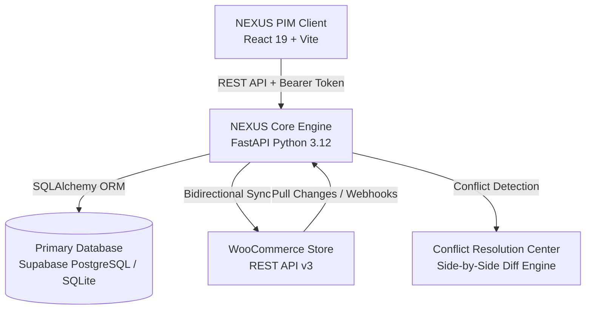

# NEXUS PIM — Enterprise Product Information Management for WooCommerce

[](https://react.dev/)
[-6D28D9?logo=fastapi&logoColor=white)](https://fastapi.tiangolo.com/)
[](https://woocommerce.com/)
[](https://supabase.com/)
[](#-design--ui-architecture)

**NEXUS PIM** is an enterprise-grade Product Information Management (PIM) system designed to centralize catalog intelligence, standardize dynamic multi-channel attribute schemas, and provide bidirectional real-time synchronization with **WooCommerce**.

---

## 🏛️ System Architecture



---

## 🎯 Core Requirements & Implementation

### 1. Product Catalog Management (`Completed` ✅)
- **Centralized Master Catalog**: Single source of truth for SKUs, titles, descriptions, pricing, sale pricing, and stock levels.
- **Status Lifecycle Engine**: Real-time tracking of product states:
  - `Synced` (Green): Matches remote WooCommerce store state exactly.
  - `Pending Sync` (Purple): Local changes staged and queued for push.
  - `Conflict` (Amber): Remote store edits differ from local master catalog.
- **Bulk Import & Export**: One-click drag-and-drop CSV importer with live preview table and catalog CSV exporter.
- **High-Resolution Media Viewer**: Interactive product image lightbox with zoom controls and thumbnail filmstrip.

### 2. Dynamic Attribute Handling (`Completed` ✅)
- **Pre-Configured Industry Templates**:
  - **Apparel & Fashion**: Color, Size, Material, Fit, Care Instructions.
  - **Electronics & Audio**: Connectivity, Battery Life, Warranty, Water Resistance.
  - **Home & Kitchen**: Dimensions, Material, Finish, Heat Rating.
  - **Footwear & Outdoor**: Shoe Size, Terrain, Waterproof Rating.
- **Dynamic Schema Builder**: Create and apply custom attribute definitions on the fly without database migrations.
- **JSON Key-Value Attribute Storage**: Infinite schema extensibility per product category.

### 3. Bidirectional WooCommerce Synchronization (`Completed` ✅)
- **Push to Store (`POST /api/sync`)**: Batch pushes local updates, pricing, stock levels, and custom attributes to WooCommerce.
- **Pull from Store (`POST /api/pull`)**: Ingests remote inventory updates or orders from WooCommerce into PIM.
- **Automated Conflict Resolution Center**: Detects field-level divergence between PIM and store with 1-click resolution (*Keep PIM Master* vs. *Accept WooCommerce Store*).
- **Sync Audit Trail**: Comprehensive chronological logging of all sync, pull, conflict, and resolution events.

### 4. Full Authentication & Access Control (`Completed` ✅)
- **Split-Screen Purple Auth Layout**: Custom brand illustration, live metric charts, and clean responsive form panels.
- **Multi-Screen Auth Flow**:
  - `/auth/login`: Email/password authentication, remember me, and Google OAuth.
  - `/auth/signup`: Registration with real-time 4-level password strength meter.
  - `/auth/forgot-password`: Security token generation and email dispatch simulation.
  - `/auth/reset-password`: Token verification and credential reset.
  - `/auth/verify-email`: 6-digit OTP boxes with auto-advance, paste support, and countdown timer.
- **Protected Routes**: React Router guards ensuring unauthenticated traffic redirects safely to `/auth/login`.

---

## 📁 Repository Structure

```
pim-woocommerce/
├── backend/                             # FastAPI Backend Engine
│   ├── data/
│   │   └── pim.db                       # Local SQLite fallback database
│   ├── database.py                      # Supabase PostgreSQL + SQLite connection pool
│   ├── main.py                          # REST API router, auth endpoints, CORS, static server
│   ├── models.py                        # SQLAlchemy ORM models (Product, User, Channel, etc.)
│   ├── schemas.py                       # Pydantic v2 request/response schemas
│   ├── seed_data.py                     # Initial catalog seeding & PBKDF2 password hashing
│   ├── woo_client.py                    # WooCommerce REST client & sandbox simulator
│   └── requirements.txt                 # Backend Python dependencies
│
├── frontend/                            # React 19 Client
│   ├── src/
│   │   ├── api.js                       # Centralized API client with JWT injection
│   │   ├── App.jsx                      # App router, dashboard views & layout orchestration
│   │   ├── index.css                    # More Purple / Cotton Candy CSS design tokens
│   │   ├── main.jsx                     # Root React entry with BrowserRouter & AuthProvider
│   │   │
│   │   ├── hooks/
│   │   │   └── useAuth.js               # Reactive auth state, session storage & auth actions
│   │   │
│   │   ├── pages/
│   │   │   └── auth/
│   │   │       ├── AuthLayout.jsx       # 45%/55% Split-screen auth layout with branding mockup
│   │   │       ├── Login.jsx            # Sign in page with validation & Google button
│   │   │       ├── Signup.jsx           # Account creation with dynamic strength meter
│   │   │       ├── ForgotPassword.jsx   # Reset link simulation & token generator
│   │   │       ├── ResetPassword.jsx    # Password update with security token
│   │   │       └── VerifyEmail.jsx      # 6-digit OTP input with auto-advance
│   │   │
│   │   └── components/
│   │       ├── auth/
│   │       │   ├── AuthForm.jsx         # Reusable inputs, strength meters & alerts
│   │       │   ├── GoogleAuthButton.jsx # White button with purple border & Google SVG
│   │       │   └── ProtectedRoute.jsx   # Route guard & loading screen
│   │       │
│   │       ├── ActivityLogView.jsx      # Real-time sync audit trail table
│   │       ├── AttributeTemplatesView.jsx # Schema & template manager
│   │       ├── BulkImportModal.jsx      # CSV drag & drop parser
│   │       ├── CatalogView.jsx          # Product catalog table, search & status filters
│   │       ├── ConflictResolutionCenter.jsx # Side-by-side divergence resolution view
│   │       ├── CornerStatusIndicator.jsx # Non-blocking ambient background task notification
│   │       ├── LogoutModal.jsx          # Sign-out confirmation modal
│   │       ├── NexusLogo.jsx            # 3D Purple-Pink cube SVG brand mark
│   │       ├── OverviewDashboard.jsx    # 5 KPI stat cards, completeness distribution & feed
│   │       ├── ProductImageViewerModal.jsx # Image lightbox viewer with zoom & filmstrip
│   │       ├── ProductModal.jsx         # Product create / edit modal with attribute form
│   │       ├── ProfileModal.jsx         # Administrator profile settings modal
│   │       ├── Sidebar.jsx              # Navigation sidebar with lavender gradient
│   │       ├── StoreSettingsModal.jsx   # WooCommerce REST API credentials modal
│   │       └── TopNavbar.jsx            # Header with Push to Woo, Pull Store, CSV & Search
│   │
│   ├── package.json
│   └── vite.config.js                   # Vite configuration with backend proxy
│
├── pim-core/                            # Native WordPress / WooCommerce Plugin
│   ├── pim-core.php                     # WordPress plugin entrypoint
│   ├── includes/                        # Sync hooks, database schema & AJAX handlers
│   └── views/                           # WordPress admin panels
│
├── .env.example                         # Environment variables template
├── Procfile                             # Production deployment configuration
├── render.yaml                          # Render cloud deployment specification
├── run.ps1                              # PowerShell launcher script
├── start.bat                            # One-click Windows launcher
└── README.md                            # Project documentation
```

---

## 🎨 Design & UI Architecture

NEXUS PIM uses a curated **MORE PURPLE** aesthetic blending light lavender, vibrant purple, and soft pink:

| Token | Value | Purpose |
|---|---|---|
| `--bg-gradient` | `linear-gradient(135deg, #FDF2FF 0%, #FCE7F3 50%, #E9D5FF 100%)` | Main application background |
| `--sidebar` | `#E9D5FF` to `#DDD6FE` | Lavender sidebar with subtle pink warmth |
| `--card` | `#FFFFFF` (1px solid `#F3D5FF`) | Clean white cards with `0 4px 12px rgba(168,85,247,0.08)` |
| `--primary` | `#6D28D9` (Hover: `#5B21B6`) | High-contrast deep purple for action buttons |
| `--primary-gradient` | `linear-gradient(90deg, #A855F7 0%, #EC4899 100%)` | Purple-to-pink gradient for active pills & highlights |
| `--text-heading` | `#1E1B4B` | Dark purple for bold typography |
| `--text-body` | `#4C1D95` | Secondary text |

---

## 🚀 Getting Started

### Prerequisites
- **Python 3.10+**
- **Node.js 18+** & `npm`

### 1. One-Click Launch (Windows)
Double-click:
```cmd
start.bat
```
Or execute in PowerShell:
```powershell
.\run.ps1
```

### 2. Manual Development Setup

#### Backend:
```bash
cd backend
python -m venv venv
# Windows:
venv\Scripts\activate
# macOS/Linux:
source venv/bin/activate

pip install -r requirements.txt
python -m uvicorn backend.main:app --reload --port 8000
```

#### Frontend:
```bash
cd frontend
npm install
npm run dev
```

Visit:
* **Frontend Application:** [http://localhost:5173](http://localhost:5173)
* **Backend API Docs (Swagger):** [http://localhost:8000/docs](http://localhost:8000/docs)

---

## 🔑 Default Administrator Credentials

| Field | Default Value |
|---|---|
| **Email** | `alex.rivera@nexus-pim.io` |
| **Password** | `password123` |
| **Role** | `Catalog SuperAdmin` |
| **Two-Factor OTP** | `849201` |

*(You can also use one-click Google Sign-In or register any new account at `/auth/signup`)*

---

## 📋 REST API Reference

### Authentication
| Method | Endpoint | Description |
|---|---|---|
| `POST` | `/api/auth/login` | Authenticate with email & password |
| `POST` | `/api/auth/signup` | Register new admin account |
| `POST` | `/api/auth/google` | Google OAuth single sign-on |
| `GET` | `/api/auth/me` | Fetch active user profile |
| `POST` | `/api/auth/logout` | Terminate session |
| `POST` | `/api/auth/forgot-password` | Generate reset token & send instructions |
| `POST` | `/api/auth/reset-password` | Update password using security token |
| `POST` | `/api/auth/verify-email` | Validate 6-digit OTP verification code |

### Products & Catalog
| Method | Endpoint | Description |
|---|---|---|
| `GET` | `/api/products` | Search, filter, and list catalog items |
| `POST` | `/api/products` | Create a new product in master catalog |
| `GET` | `/api/products/{id}` | Retrieve individual product details |
| `PUT` | `/api/products/{id}` | Update product & queue for sync |
| `DELETE` | `/api/products/{id}` | Remove product from catalog |
| `POST` | `/api/products/bulk-delete` | Batch delete selected products |
| `POST` | `/api/import-csv` | Parse and import products from CSV |
| `GET` | `/api/export-csv` | Download complete catalog as CSV |

### Synchronization & Channels
| Method | Endpoint | Description |
|---|---|---|
| `POST` | `/api/sync` | Push pending products to WooCommerce |
| `POST` | `/api/pull` | Scan store for remote updates & conflicts |
| `POST` | `/api/products/{id}/resolve`| Resolve conflict (`keep: "pim"` or `"woo"`) |
| `GET` | `/api/channels` | List connected sales channels |
| `PUT` | `/api/channels/{id}` | Update WooCommerce API keys & URL |
| `POST` | `/api/channels/test` | Test live WooCommerce REST connection |
| `GET` | `/api/activity` | Retrieve chronological sync audit trail |

---

## 📄 License

This project is open-source and available under the [MIT License](LICENSE).
